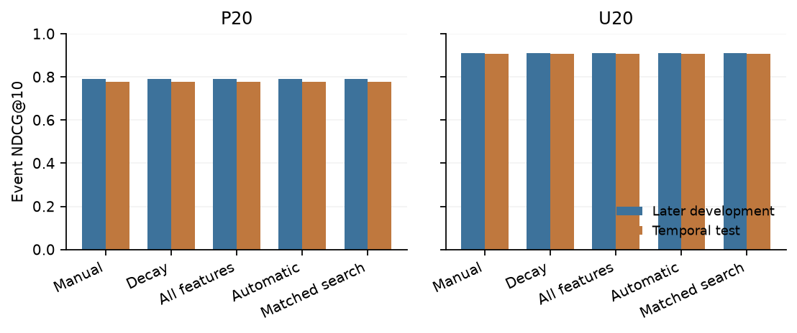
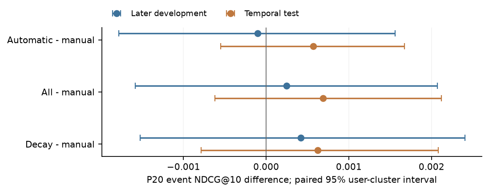

# Reading the study

Can automatic temporal feature groups compete with a manual gradient-boosting scorer?

Read [the paper](main.pdf), then inspect the [numerical evidence](../../evidence/submission/final.json),
[search trace and development slices](../../evidence/submission/study.json) and [research decisions](../../research/decisions).

## Methods

One nested 1,000-user cohort with complete retained histories; fixed training/model/candidate rules;
six automatic one-group additions selected on earlier P20 development; later development used for checking;
fitted finalists frozen before one temporal holdout evaluation. U20 is a protocol sensitivity condition.
Earlier baseline and Linux/Mac reproductions reuse data and are not independent replications.

The automatic procedure selected **25 features**; added groups: `user_item_decay_all`.
Its P20 final automatic-minus-manual event NDCG@10 is **+0.000567 [-0.000550, +0.001672]**.
The interval spans zero: these data do not establish a gain or loss in event-average ranking. Its lower endpoint exceeds the chosen -0.005 tolerance, supporting that limited tolerance claim here. A gain of 0.005 is outside the reported interval.

## P20 results

| Method | Features | Later development NDCG@10 | Test NDCG@10 | Test Recall@10 |
|---|---:|---:|---:|---:|
| Original | 9 | 0.787039 | 0.773804 | 0.903050 |
| No pair | 6 | 0.384224 | 0.378794 | 0.677550 |
| Manual | 17 | 0.790649 | 0.778141 | 0.903850 |
| Decay | 17 | 0.791068 | 0.778764 | 0.906400 |
| All features | 47 | 0.790897 | 0.778828 | 0.906550 |
| Automatic | 25 | 0.790544 | 0.778708 | 0.903250 |
| Matched search | 25 | 0.790544 | 0.778708 | 0.903250 |

Development: 20,000 queries / 744 evaluated users. Test: 20,000 queries /
772 users, including 4,604 novel queries. Cohort size and evaluated-user counts differ.
The test is [23,400,000, 26,000,000] in recorded seconds. All reported test models retain their train-only fits.

## Interpretation and limitations

- Automatic selection chose an actual temporal group; its quality is judged on check/test, not its selection maximum.
- Both searches cover the same six one-group additions in different orders. Their agreement is expected under this exhaustive one-round comparison; it does not distinguish optimizer quality.
- No-pair-minus-original on P20 test: -0.395010 [-0.407967, -0.383487] overall; +0.066338 [+0.052535, +0.078552] on novel targets.
- Fewer columns do not establish lower feature-construction cost: all 47 columns are built upstream.
- One small, development-adaptive study; sampled candidates, training-catalog eligibility and retained-cohort counts.
  This is not a full-catalog leaderboard or an exposure-corrected causal result.

## How to inspect or reproduce

- [Run, analysis and freeze identities](provenance.md).
- [Reproduction commands](../../docs/reproduction.md): figures/paper from saved evidence, or full raw-data computation.
- [Research hypotheses and decisions](../../research).
